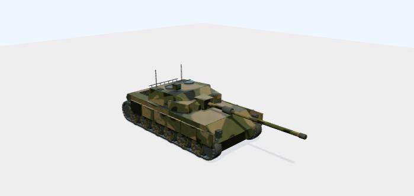
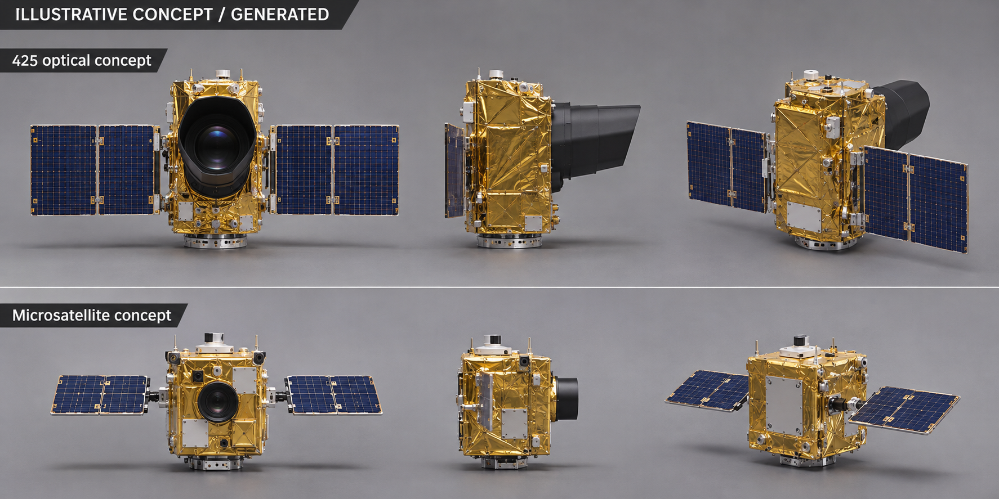

# K2 현실감 구현 분석과 Blender 적용 방법

작성: 2026-11-04. 현재 저장소의 실행 경로, 제작 스크립트, 실제 GLB 바이너리·내장 이미지를 확인한 결과다. 첨부 화면의 URL이 없으므로 픽셀만으로 자산 버전을 단정하지 않는다. 전체39종 관찰 화면에서 사용하는 `k2-pipeline.glb`를 중심으로, 기존 둘러보기의 `k2-photo-pbr.glb`도 구분해 분석했다.

핵심은 **이미지 참고 → 부품별 형상 제작 → 모서리·차륜 디테일 → 재질별 UV/PBR → 조명·그림자 → GLB 검증 → 웹 조작**의 누적이다. 현재 K2의 현실감은 이 제작 수준에서 나온다. 공통 뷰어·PBR 파일 형식·모션을39종에 적용한 것과,39종의 형상·재질 품질을 K2와 같게 만든 것은 별개의 결과다.



## 1. 먼저 구분해야 하는 K2 버전

| 화면·버전 | 실제 GLB | 특징 |
| --- | --- | --- |
| 전체39종 `?view=fleet&item=k2` | `public/models/k2-pipeline.glb` | 전용 보정 형상, 위장 baseColor, normal, metallicRoughness,3개 내장 클립 |
| 상세의 `?system=k2&model=pipeline` | 같은 `k2-pipeline.glb` | 같은 자산을 ModelStudio로 관찰 |
| 기존 K2 기본 자산 설정 | `public/models/k2-photo-pbr.glb` | 사진 색상 샘플·절차적 무늬·먼지 tint가 적용된 다른 제작 계열 |
| `model=photo-study` 시험 | `public/models/k2-photo-study.glb` | AI 추정4면 이미지를 UV 투영한 시험. 왜곡이 남아 기본으로 승격하지 않음 |

근거: [전체 관찰 연결](../src/fleet-experience.js), [자산 목록](../src/fleet-assets.json), [기존 K2 설정](../src/vehicle-models.js), [쿼리별 연결](../src/equipment-assets.js).

따라서 기존 photo-PBR 경로의 색상 샘플링이나 별도 지형 경로의 접지 그림자 기능을, 첨부와 같은 평지 ModelStudio 화면에 전부 적용된 기술로 합쳐 설명하면 안 된다.

## 2. 실제 기술 스택

버전은 저장소 lockfile과 Blender 제작 보고서를 기준으로 한다. 외부 문서의 최신 버전으로 바꿔 적지 않았다.

| 계층 | 기술·버전 | 실제 역할 |
| --- | --- | --- |
| 참고 자료 | 공개 K2 사진·제조사 소개, AI 추정4면 참고판 | 외형·색·배치를 판단하는 제작 자료 |
| 초기 형상 | Three.js 0.180.0, GLTFExporter, 자체 형상 생성기 | 차체/포탑/포신/차륜/궤도와 피벗 분리 |
| 자산 제작 | Blender 4.5.9 LTS, Python `bpy`, NumPy | 메시 정리·bevel·UV·텍스처·재질·NLA·GLB export |
| PBR | Blender Principled BSDF → glTF metallic-roughness 재질 | 도장·금속·고무·광학부의 서로 다른 빛 반응 |
| 웹 관찰 | Three.js WebGLRenderer, GLTFLoader, OrbitControls | 실제 메시 렌더, 회전·확대·시점 변경 |
| 부품·모션 | Raycaster, AnimationMixer, Object3D 부모/피벗 | 부품 선택·강조·포커스, 내장 클립 재생 |
| 최적화 | glTF-Transform 4.5.1 | 불필요 접선 정리, 중복 리소스 제거, weld |
| 구조 검사 | gltf-validator 2.0.0-dev.3.10 | GLB 구조·참조·접선 등 검사 |
| 웹·검증·배포 | vanilla JS/HTML/CSS, Vite7.3.7, Playwright, GitHub Pages | UI, 빌드, 브라우저 테스트, 게시 |

Cesium1.146.0은 별도의 위성·고도 지형 경로에 사용한다. 첨부와 같은 평지 ModelStudio의 렌더는 Three.js가 담당한다. 해당 뷰어에는 React/R3F, 물리 엔진, HDRI 환경맵 로딩, 실시간 레이트레이싱, SSAO의 구현이 확인되지 않는다.

## 3. K2 전용 제작의 실제 계보

```text
scripts/create-ground-models.mjs
  → k2-exhibit.glb                     부품별 초기 메시
  → scripts/blender/k2_surface_refinement.py
  → k2-surface-refinement.glb          형상 모서리·재질·위장·림 볼트
  → blender/k2/build.py
  → blender/k2/source.blend            UV/PBR/NLA 제작 원본
  → artifacts/3d/k2-pipeline/raw.glb
  → scripts/optimize-k2.mjs
  → public/models/k2-pipeline.glb
  → ModelStudio / GLTFLoader / AnimationMixer
```

`k2_surface_refinement.py`는 AI 투영 시험본을 먼저 비교 렌더하지만, 개선본 제작에는 **기존 k2-exhibit 형상을 다시 임포트**한다. 현재 pipeline의 위장 텍스처는 AI4면 이미지를 그대로 투영한 결과가 아니다.

### 3-1. 실제 형상과 작은 디테일

- 차체 `Hull`, 포탑 `Turret`, 포신 `Gun`, 주행부 `RunningGear`, 마킹 `Markings`를 분리한다.
- `Gun`은 `Turret` 하위이며 차륜·좌우 궤도도 독립 그룹으로 구성한다.
- 궤도에는 개별 슈와 고무 패드를 배치하고, 차륜에는 림·허브·체결부를 만든다.
- 중복된 삼각형 꼭짓점을 weld하고 노멀을 정리한다.
- 약0.012~0.018m 폭,2세그먼트 bevel을 적용해 모서리에 실제 하이라이트가 생기게 한다. 이 수치는 제작값이며 실장비 모서리 치수 인증이 아니다.
- 전용 보정 단계에서12개 차륜에 림 체결부96개를 추가한다.

사진처럼 보이는 작은 점을 텍스처로만 붙이는 것과 달리, 이런 실제 형상은 시점을 바꿔도 두께와 그림자를 유지한다. 단, bevel로 늘어난 삼각형 수가 곧 정확한 형상이나 더 나은 실루엣을 뜻하지는 않는다.

근거: [초기 생성기](../scripts/create-ground-models.mjs), [K2 전용 보정](../scripts/blender/k2_surface_refinement.py).

### 3-2. 도장·금속·고무·광학부의 재질 구분

한 재질로 전체를 칠하지 않고 역할별로 반응을 달리한다.

| 역할 | K2 제작값의 예 | 보이는 효과 |
| --- | --- | --- |
| 도장 외장 | roughness 약0.77, metallic 약0.12 및 맵 변동 | 무광 도장 위의 부드러운 반사 |
| 노출 금속·궤도 | roughness0.68, metallic0.72 | 상대적으로 금속다운 하이라이트 |
| 고무 | roughness0.94, metallic0 | 어둡고 반사가 약한 타이어·패드 |
| 그릴·틈 | 어두운 색, roughness0.85 | 움푹한 외부 부위의 깊이감 |
| 광학부 | roughness0.18, metallic0.25 | 작고 선명한 반사 표현 |

이 값은 현재 전시 재질의 예술적 설정이다. 실제 재료 측정값이나 광학 유리의 완전한 투과·굴절 모델을 의미하지 않는다.

### 3-3. K2 pipeline의 실제 이미지3개

| 용도 | 내장 이미지 | 크기 | 제작 방법 |
| --- | --- | --- | --- |
| Base Color | `authored-camo` | 1024×1024 | 올리브·모래·짙은색3계열의 절차적 위장과 작은 색 노이즈 |
| Normal | `AuthoredPaintNormal` | 256×256 | 서로 다른 표면 방향을 만드는 작은 사인/코사인 변화 |
| Metallic-Roughness | `AuthoredPaintMetalRough` | 256×256 | G에 roughness, B에 metallic 데이터 |

Normal·Metallic-Roughness는 색 이미지와 구분해 Non-Color 데이터로 처리한다. 현재 K2에는 별도의 `occlusionTexture`가 없다. Metallic-Roughness 이미지의 R값이1이라는 사실을 AO 베이크가 구현됐다는 뜻으로 해석하면 안 된다.

최종 pipeline에서는 Smart UV Project로 UV를 다시 펼친다. 실제 사진 속 위장 패턴을 위치까지 정합한 unwrap·스캔은 아니다. 모든 이미지는 GLB에 내장되고 Blender 원본에도 packed되어 있다.

근거: [UV·PBR·NLA 생성기](../blender/k2/build.py), [바이너리 검사 결과](K2-REALISM-AUDIT.json).

### 3-4. IMAGE를 활용한 별도 photo-PBR 경로

[photo_pbr.py](../scripts/blender/photo_pbr.py)는 실제 사진의 지정된 작은 영역에서 색을 샘플링한다. 샘플 색25%와 제작 도장색75%를 혼합하고,1024² 위장·roughness·normal을 절차적으로 만든다. 하부에 `ExteriorSoil` 정점색 tint를 추가하고 외부 패널·체결부·미세 bevel을 보강한다.

즉, 이 경로도 사진1장을 자동으로 정확한3D 형상으로 복원한 작업은 아니다. 사진은 색과 외형 판단에 쓰고, 메시·재질은 별도로 제작한다. 이 작업을 현재 pipeline의 이력과 혼합하지 않고 선택한 GLB에 따라 적용한다.

## 4. 첨부 화면에서 중요한 웹 조명·표현

[model-studio.js](../src/model-studio.js)의 실제 설정:

| 항목 | 현재 값 |
| --- | --- |
| 출력·톤매핑 | sRGB / ACESFilmic / exposure1.15 |
| 주변광 | HemisphereLight, 강도2.2 |
| 주광 | 따뜻한 DirectionalLight, 강도3, 위치(8,16,-9) |
| 보조광 | 푸른 DirectionalLight, 강도1.5, 위치(-10,6,7) |
| 그림자 | PCFSoftShadowMap,1024², normalBias0.035 |
| 바닥 | roughness1인 실제 PlaneGeometry, 모델 바닥보다0.015 아래 |
| 카메라 | PerspectiveCamera, FOV38°, 실제 bounding box에 맞춰 거리 계산 |
| 렌더 부담 | pixel ratio 최대1.5, 저사양 모드에서는1·그림자 해제 |

재질만 좋아도 바닥에 닿는 그림자와 모서리의 명암이 없으면 물체가 떠 있거나 평평해 보일 수 있다. K2 화면에서는 부품의 실제 형상과 위 설정이 함께 깊이감을 만든다. 다른 체계도 같은 ModelStudio를 사용하므로, 현재 차이를 조명 설정 하나로 설명하기는 어렵다.

Blender 검토 PNG는 Cycles·면광원·AgX를 쓰는 별도 환경이다. 웹은 WebGL·ACES이므로, Blender PNG가 좋아 보이는 것과 웹에서 같은 품질로 나오는 것을 각각 확인해야 한다.

접지 그림자512²를 Cycles Shadow Catcher로 만드는 과거/별도 지형 구현도 존재한다. 그러나 위 평지 ModelStudio는 실시간 주광 그림자를 사용하며 이 접지 PNG를 직접 로딩하지 않는다. `contact_shadows.py`의 기능을 첨부 장면에 적용된 기능으로 잘못 합산하지 않는다.

## 5. 리깅·애니메이션·관찰 기능

본격적인 캐릭터 스키닝보다 **부품별 부모 계층과 회전 원점**을 사용한다.

```text
ExhibitRoot                 전시대 회전
└─ 기존 K2 루트
   ├─ Hull
   ├─ Turret                포탑 회전
   │  └─ Gun                포신 고저
   ├─ RunningGear
   │  ├─ Track_L / Wheel_*
   │  └─ Track_R / Wheel_*
   └─ Markings
```

Blender NLA의 `Turntable`, `TurretTraverse`, `BarrelElevation`을30fps·4초 클립으로 export한다. 이30fps는 제작 타임라인 설정이며 브라우저 표시 FPS와 다르다. 웹에서는 AnimationMixer가 클립을 재생하고, OrbitControls가 회전·확대, Raycaster가 실제 부품 선택을 담당한다. 선택 강조·카메라 포커스·수동 포탑/포신·외형 분리·구조선·재시도·동작 감소·자원 해제를 공통 제공한다.

이 모션은 교육용이다. 실제 포탑 속도·현가장치·궤도 주행 물리나 무장 제어를 구현한 것으로 해석하지 않는다.

근거: [K2 NLA 제작](../blender/k2/build.py), [클립·선택 처리](../src/studio-motion.js).

## 6. 다른 체계가 모형처럼 보이는 이유: 실제 자산 비교

현재 GLB에서 직접 계산했다. 삼각형 수는 공유 mesh 리소스의 합이 아니라 **노드별로 화면에 배치되는 메시 인스턴스를 합산**한 값이다.

| 자산 | 장면 삼각형 | 이미지 | 표면·제작 차이 |
| --- | ---: | ---: | --- |
| K2 초기 exhibit | 20,304 | 0 | 초기 부품별 형상 |
| K2 현재 pipeline | 98,224 | 3 | 전용 bevel·림 체결부·위장·변동 normal·재질 역할 |
| K9 fleet | 41,448 | 7 | 이미 위장/PBR을 보유. 형상·사진 정합과 재질 배치의 개별 검토가 필요 |
| K808 fleet | 2,728 | 6 | 간략 외형,128² 표면 기본값, 평면 normal |
| 500MD fleet | 2,269 | 7 | 간략 동체·로터,128² 표면 기본값, 평면 normal |

K2 normal 이미지에는 실제로48종의 RGB 조합이 있고, 검사한 K808·500MD normal 이미지는 각각 RGB값1종뿐이었다. 후자는 normal 슬롯이 있어도 미세 요철 변화가 없는 평면 기본값이다. 파일·이미지 수만으로 표면 디테일을 평가할 수 없는 구체적인 예다.

K9처럼 K2보다 이미지 수·해상도가 큰 체계도 있다. 따라서 일괄 해상도 확대만으로는 해결되지 않는다. 실제 실루엣, 부품의 두께·위치, UV의 크기/배치, 재질별 명암을 함께 보완해야 한다. 삼각형 수는 투자된 형상 작업의 단서이며 정확도·현실감 점수는 아니다.

## 7. 다른 무기체계에 적용할 제작 순서

1. **비교 기준 고정:** 목표 사진과 현재 GLB, 웹 카메라·조명을 기록한다. 사진/AI 참고판/공개 도면과 권리를 구분한다. AI 참고판의 보이지 않는 면은 확인 대상이다.
2. **실루엣과 비례:** 해당 체계의 차체·포탑·날개·동체·함체 등 주요 윤곽과 길이/폭/높이 관계부터 맞춘다. K2 메시를 다른 체계에 그대로 재사용하지 않는다.
3. **실제 부품 형상:** 외부 패널, 차륜/궤도, 흡기구·배기구, 창·센서 커버 등 관찰 가능한 요소를 분리한다. 시점 변화에 필요한 두께와 곡면을 만든다.
4. **면·모서리:** 중복 꼭짓점·노멀·불필요 면을 정리하고 장비 크기에 맞는 작은 bevel을 준다. 재질 구분과 피벗은 유지한다.
5. **재질별 UV:** 도장·금속·고무·유리·태양전지판에 맞는 UV와 반복 크기를 설정한다. 한 장의 사진을 전체 메시로 투영해 패널·바퀴가 늘어지는 방식은 품질 기준으로 채택하지 않는다.
6. **PBR 실제 제작:** 의미 있는 baseColor, 비균일 roughness, 필요한 부위의 normal·metallic을 만든다. 먼지·마모는 위치와 재질에 맞춰 절제한다. AO가 필요하면 실제 베이크하고 기본 R값과 구분한다.
7. **동일한 광원에서 비교:** Blender 세 시점과 실제 웹 화면을 확인한다. K2의 조명·노출을 재사용해 자산 차이를 먼저 평가한다. HDRI 등 새 표현을 도입할 때는 별도 비교한다.
8. **장비별 부품 모션:** 존재하는 회전익·프로펠러·포탑 등만 피벗을 맞춘다. 관찰용 회전·분리와 실제 성능 재현을 구분한다.
9. **GLB·웹 검증:** UV/재질/채널/접선/클립/단위·축/출처를 검사하고 모바일·터치·동작 감소·로딩 실패를 확인한다. 최적화 전후의 형태·재질·클립을 비교한다.
10. **개별 품질 판정:** 구조 검사 통과와 사진에 가까운 외관을 별도로 판정한다. 전면 재생성 대신 필요한 한 체계의 메시·UV·재질만 수정한다.

우선순위는 **공통 라이브러리 추가보다 체계별 원본 형상과 재질 제작의 깊이를 K2 수준으로 올리는 것**이다. K9는 이미 가진 PBR을 활용해 형상·UV·재질 배치를 우선 확인하고, K808·500MD 같은 간략 자산은 부품 형상과 비균일 재질 제작부터 시작한다.

재사용 시에는 K2 전용 스크립트의 아래 가정을 설정으로 분리해야 한다.

| 그대로 공유할 기반 | 체계별로 맞출 제작 데이터 |
| --- | --- |
| GLTFLoader·뷰어·선택·클립 재생·검증 | 부품 이름·회전 원점·부모 관계 |
| PBR 채널 연결과 색/데이터 구분 | 도장·금속·고무·유리 등 부위별 재질 역할 |
| weld·bevel 처리 방식 | 실제 크기에 맞는 bevel 폭·곡면·외부 디테일 |
| UV/텍스처 제작 절차 | 표면별 UV 배치·반복 크기·위장/패널 패턴 |

특히 `k2_surface_refinement.py`는 `Mesh_숫자` 인덱스와 `Wheel_` 이름, K2 전용 재질 이름으로 분류한다. 이 코드를 다른 GLB에 그대로 실행하면 부품·재질을 잘못 분류할 수 있다. 다른 체계에는 명시적인 부품→재질 역할 설정을 먼저 작성한다. 차륜 개수·위장 배치·bevel 치수도 일괄 복사할 항목이 아니다.

## 8. 재현·검증에 사용할 파일

| 대상 | 파일 |
| --- | --- |
| K2 최신 Blender 원본 | `blender/k2/source.blend` |
| 형상·위장·bevel·림 볼트 보정 | `scripts/blender/k2_surface_refinement.py` |
| 최신 UV/PBR/클립 생성 | `blender/k2/build.py` |
| 별도 사진 색상 PBR | `scripts/blender/photo_pbr.py` |
| 최적화·접선 정리 | `scripts/optimize-k2.mjs` |
| 바이너리·원본 해시 검사 | `scripts/qa/k2-pipeline.mjs` |
| 다른 체계의 현재 제작 수준 | `blender/fleet/`, `src/fleet-assets.json` |

현재 K2는 약7.05MB,5개 재질 역할,165개 메시 인스턴스·66개 공유 메시 리소스,내장 이미지3개·클립3개다. 최적화는 정규화본7,239,336 →7,049,400bytes이며 geometry 대체용 압축이 아니라 중복 정리·weld 중심이다.

원형 생성기와 기존 보정 스크립트에는 고정 출력 경로가 있으므로, 다른 체계 적용 시 별도 설정·산출 경로로 분리한 후 검증한다. 이번 분석에서는 모델을 재생성하거나 배포를 변경하지 않았다.

읽기 전용 확인 명령:

```powershell
node scripts/qa/k2-pipeline.mjs
Get-Content blender/k2/build-report.json
Get-Content blender/k2/optimization-report.json
Get-Content docs/K2-REALISM-AUDIT.json
```

2026-11-04 K2 검사를 다시 실행하여 오류0/경고0,원본 해시 보존,이미지3개·클립3개를 확인했다. 형상의 사진 정합·실사 품질 인증을 의미하지 않는다.

공식 참고: [Three.js PBR 재질](https://threejs.org/docs/pages/MeshStandardMaterial.html), [GLTFLoader](https://threejs.org/docs/pages/GLTFLoader.html), [AnimationMixer](https://threejs.org/docs/pages/AnimationMixer.html), [glTF2.0 명세](https://github.com/KhronosGroup/glTF/tree/main/specification/2.0). 저장소의 구현·버전 판단은 위 로컬 소스와 실제 GLB를 우선했다.

## 6. 대표 체계의 Blender → Three.js / Unreal Engine 구성

지도는 위치와 체계 선택을 돕는 간략한 배경으로 유지한다. 시각 검수의 대상은 무기체계 자체다. Blender에서 미터 단위로 형상, 부품 원점, UV, PBR, 전시 모션을 관리한다. 웹은 최적화한 GLB를 Three.js로 읽고, Unreal 전시 프로젝트도 같은 GLB를 Interchange로 읽는다. 두 화면에서 기준 모델을 하나로 유지해야 날개 폭이나 포탑 회전축을 한쪽에서만 고치는 문제를 피할 수 있다.

사용자 제공 Threads 본문은 한 장의 그림을 바탕으로 여러 객체로 구성한 기차를 만들고 Blender와 Unreal에서 게임·도시를 제작한 사례를 소개한다. 이를 전시에는 외부 사진을 부품 단위의 Blender 장면으로 해석하고 같은 장면을 두 엔진에서 확인하는 방식으로 적용한다. 구체적인 UE 가져오기 설정은 Epic 문서를 따른다. [Threads 원문](https://www.threads.com/@choi.openai/post/Dc3EZU-D2H2) · [Epic의 장면 가져오기 설명](https://dev.epicgames.com/documentation/unreal-engine/importing-assets-using-interchange-in-unreal-engine)

| 구분 | 대표 자산 | 사진과 대조할 요소 |
| --- | --- | --- |
| 육군 | K2 흑표, K9 자주포 | 차체와 포탑 비율, 차륜 간격, 궤도 접지, 도장과 고무의 반사 차이 |
| 해군 | 도산안창호급, 충남함 | 잠수함 선체 곡률과 함교, 호위함 선수와 상부 구조물의 실루엣 |
| 공군 | FA-50, KF-21 보라매 | 평면 날개 윤곽, 흡입구와 노즐 수, 캐노피 투과와 반사 |
| 해병대 | KAAV 상륙돌격장갑차 | 선수 경사, 측면 부력 구조, 궤도와 차체 접합 |
| 우주 | 425사업 광학형 개념, 초소형위성체계 개념 | 본체와 전개 패널의 연결, 셀과 단열재의 서로 다른 반사. 형상이 공개되지 않은 면은 추정으로 표시 |
| 무인기 | 중고도 MUAV, 소형 리모아이-002B | 축척별 날개와 동체 비율, 프로펠러 중심, 센서 하우징. 리모아이의 기준 전폭 1.80 m, 전장 1.44 m |

리모아이의 형태와 크기는 제조사 공개 규격을 참고한다. 자료가 적은 위성은 공개 사업자료와 생성 참고도를 별도로 관리한다. 생성도의 광학 개구부와 금색 단열재는 재질 연구용이다. 425의 다른 위성 형상이나 초소형위성 탑재체를 식별하는 근거로 쓸 수 없다. [유콘시스템 리모아이-002B](https://www.uconsystem.com/products/military/remoeye-002b.asp) · [방위사업청 425사업](https://dapa.go.kr/dapa/doc/selectDoc.do?bbsSeq=326&docSeq=19681&menuSeq=3069) · [방위사업청 초소형위성체계](https://dapa.go.kr/dapa/doc/selectDoc.do?bbsSeq=326&docSeq=20862&menuSeq=3069)



### Unreal에서 재현하기

1. UE5에서 `unreal/DefenseExhibit/DefenseExhibit.uproject`를 열고 빈 레벨을 준비한다.
2. Output Log의 Python 모드에서 아래 두 줄을 실행한다. ID를 바꾸면 같은 카탈로그에서 다른 모델을 선택한다.

   ```python
   exec((__import__('pathlib').Path(unreal.Paths.convert_relative_path_to_full(unreal.Paths.project_dir())) / 'import_exhibit.py').read_text(encoding='utf-8'))
   import_exhibit('remoeye')
   ```

3. Outliner에서 부품 계층과 피벗을 확인하고, 중성 바닥·방향광·Sky Light를 배치한다. 전시용 Level Sequence에서 정면, 측면, 사분면 카메라를 같은 초점거리로 저장한다. 애니메이션 트랙 유무, 재생 중 접합부, 단위 변환을 확인하고 레벨을 저장한다. 편집기 실행 및 저장된 레벨 재생은 아직 검증 대기다.

### 실사 품질 판단과 재개 지점

#### 3e28afe 이후의 보정

KF-21 작업본의 주 도장 메시를 11개 타원 단면의 동체, 두께가 변하는 좌우 주익, 수평미익, 경사진 수직미익으로 재구성했다. 원본 MVP GLB와 캐노피·착륙장치의 좌표는 보존했다. 425·초소형위성은 외장 네 면에 가장자리에서 팽팽하고 중앙에 사선 주름이 생기는 단열재 메시를 적용했다. 단면과 주름은 공개 외형 해석에 따른 제작 값이다.

브라우저에서는 장비 반경에 따라 주 조명의 위치와 그림자 범위를 조절하고 실내 환경 반사를 제공한다. K2를 첫 줄에 놓고 같은 카메라 프리셋으로 비교한 [11종 5시점 비교판](modeling/representative-angles/)에서 정면·우측·후면·상면·사선을 확인할 수 있다. 비교판은 개별 장비가 화면에 맞도록 확대하므로 장비 간 절대 크기를 읽는 용도에는 맞지 않는다.

**Unreal 재생 확인 방법.** 기본 조명과 Player Start가 있는 새 레벨에서 위 Python 코드를 로드하고 `import_exhibit('kf21')`, `play_exhibit('kf21')`를 순서대로 실행한다. 두 번째 함수는 PIE 월드에서 플레이어 카메라를 장비 주위로 6초간 이동시킨다. 실제 카메라 위치 변화가 확인되면 프로젝트의 `Saved/PIE-kf21.json`에 엔진 버전, 월드 이름, 위치 샘플을 쓴다. 이 기록은 카메라 재생을 확인하며 GLB 내장 부품 클립의 UE 재생은 별도로 확인해야 한다. 현재 작업 PC에서는 에디터 실행 및 이 기록 취득이 보류 상태다.

GLB 검사와 별도로 동일 시점의 실사진과 Blender·웹·UE 캡처를 나란히 놓는다. 먼저 주 실루엣과 부품 위치를 맞춘 후, 비스듬한 조명에서 도장·고무·유리·금속의 차이를 확인한다. 세부 형상과 재질을 모두 통과한 체계만 실사 검수 완료로 기록한다. 현재 패스는 기존 이미지 재질 보존, 무텍스처 재질의 미세 요철·거칠기, 위성 외장, 소형 드론 추가 단계다. 다음 작업은 체계별 사진 정합과 세부 형상 보정, UE 캡처 비교다.
